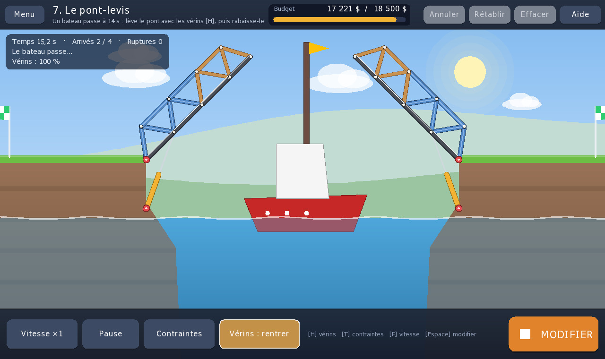
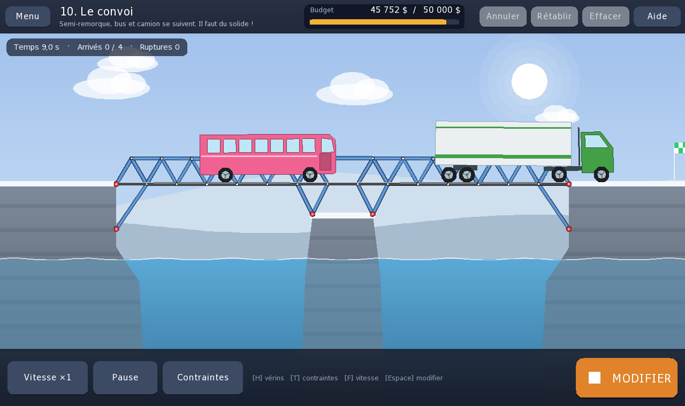
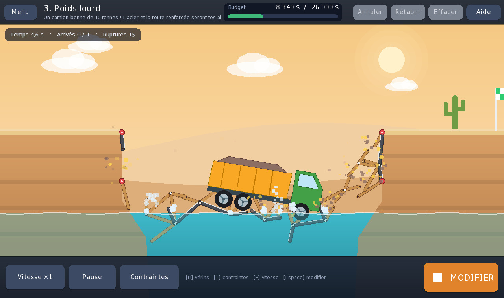
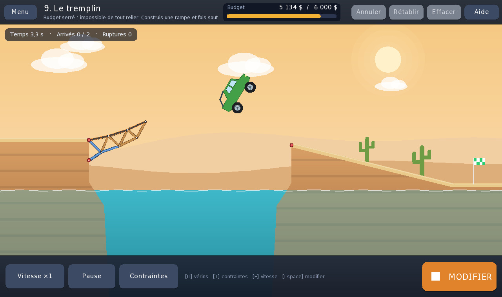
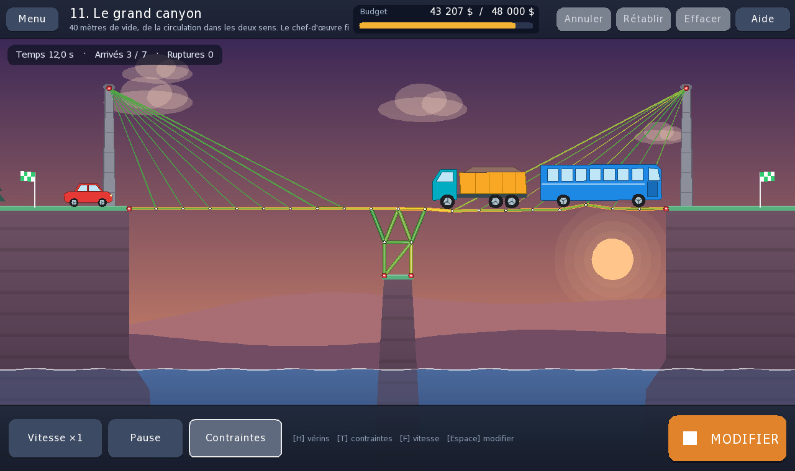

# Travée — Bâtisseurs de ponts

Jeu original de construction de ponts en 2D, disponible en trois versions :

| Version | Où | Technologie |
|---------|----|-------------|
| **Web** (ordinateur et téléphone, tactile) | https://travee-ponts.netlify.app | HTML5 Canvas + JavaScript (`web/`) |
| **Android** | `dist/Travee.apk` (aussi téléchargeable depuis le site) | Application native Java + WebView, hors ligne (`android/`) |
| **Windows** | `dist/Travee.exe` (aussi téléchargeable depuis le site) | C++ Win32 + GDI+, exécutable PE32+ 64 bits autonome (`src/`) |

Les trois versions partagent la même physique, les mêmes 12 niveaux et les mêmes budgets :
`web/core.js` est un port fidèle de `src/core.h`, vérifié par le même banc d'essai.

Construis des ponts avec différents matériaux, lance la simulation physique et regarde
voitures, motos, bus, camions et semi-remorques traverser… ou finir dans l'eau.


| Éditeur (vue plan)            | Pont-levis et bateau            |
|-------------------------------|---------------------------------|
|     |    |
| **Convoi lourd**              | **Rupture sous un camion de 10 t** |
|     |     |
| **Tremplin pour 4x4**         | **Grand canyon, vue des contraintes** |
|         |       |

## Contenu

- **12 niveaux** : premier pont, ruisseau, poids lourd, rocher central, gouffre à câbles,
  côte à gravir, pont-levis avec bateau, double sens, tremplin pour 4x4, convoi lourd,
  grand canyon, et un bac à sable au budget illimité.
- **8 matériaux** :

  | Matériau        | Coût/m | Longueur max | Particularité                                |
  |-----------------|-------:|-------------:|----------------------------------------------|
  | Route           |  200 $ |          2 m | Seule surface où roulent les véhicules        |
  | Route renforcée |  360 $ |          2 m | Pour bus et camions                           |
  | Bois            |  100 $ |          2 m | Léger, bon marché                             |
  | Acier           |  400 $ |          4 m | Très solide                                   |
  | Corde           |   30 $ |         10 m | Traction seulement, souple                    |
  | Câble           |   90 $ |         20 m | Traction seulement, très résistant            |
  | Ressort         |  220 $ |          2 m | Élastique, absorbe les chocs                  |
  | Vérin           |  600 $ |          4 m | S'allonge ou se rétracte avec [H], course réglable |

- **8 véhicules** : citadine, moto, fourgon, 4x4, bus, camion-benne (10 t), semi-remorque
  articulée (tracteur + remorque), et bateaux qui passent sous les ponts-levis.
- Simulation physique **XPBD** (32 sous-pas par image) : poutres élastiques qui se tordent et
  **cassent** quand l'effort dépasse leur résistance, suspensions amorties, adhérence des
  roues, flottaison, éclaboussures.
- Vue des **contraintes** (vert → rouge), ralenti/accéléré, pause.
- Budget, étoiles (★ réussi, ★★ ≤ 90 % du budget, ★★★ ≤ 75 %), records.
- Sauvegarde automatique de la progression et des ponts (`travee_sauvegarde.txt` à côté de l'exe,
  ou dans `%APPDATA%\Travee` si le dossier est protégé).
- Sons synthétisés à la volée (pose, rupture, plouf, klaxon, victoire).

## Commandes

| Action                         | Commande                                              |
|--------------------------------|-------------------------------------------------------|
| Poser une poutre               | Clic gauche sur une articulation, glisser et relâcher |
| Poser en chaîne                | Clic sur une articulation, puis un clic par poutre    |
| Annuler la poutre en cours     | Clic droit ou Échap                                   |
| Supprimer                      | Clic droit (ou Suppr) sur une poutre / articulation   |
| Déplacer une articulation      | Maj + glisser                                         |
| Placement libre (sans grille)  | Ctrl maintenu                                         |
| Choisir le matériau            | Touches 1 à 8 ou clic sur la palette                  |
| Régler un vérin                | + / − (ou Maj + molette) en survolant le vérin         |
| Tester / modifier              | Espace                                                |
| Actionner les vérins           | H (pendant le test)                                   |
| Contraintes / vitesse / pause  | T / F / P                                             |
| Zoom / déplacer la vue         | Molette / glisser dans le vide                        |
| Recentrer                      | R                                                     |
| Annuler / rétablir             | Ctrl+Z / Ctrl+Y                                       |
| Aide                           | F1                                                    |

## Commandes tactiles (web et Android)

| Action | Geste |
|--------|-------|
| Poser une poutre | Glisser depuis une articulation, ou toucher une articulation puis chaque point suivant |
| Finir un tracé | Bouton « Terminer » ou retoucher le dernier point |
| Supprimer / régler un vérin | Toucher la poutre, puis « Supprimer » ou − / + |
| Déplacer une articulation | Appui long puis glisser |
| Zoom / déplacer la vue | Pincer / glisser dans le vide |
| Retour (Android) | Ferme l'aide, revient à l'éditeur, puis au menu |

## Compiler

Depuis Linux (cross-compilation) :

```bash
sudo apt install g++-mingw-w64-x86-64-posix
./build.sh            # produit dist/Travee.exe
```

APK Android (depuis Linux) :

```bash
sudo apt install android-sdk-platform-23 aapt dalvik-exchange zipalign apksigner openjdk-17-jdk-headless
android/build_apk.sh  # produit dist/Travee.apk (signé v1/v2/v3, Android 5.0 et plus, cible API 34)
```

La clé de signature est créée au premier lancement dans `android/keystore/` (non versionnée) :
conservez-la pour publier des mises à jour installables par-dessus la version précédente.

Site web : `./prepare_site.sh` assemble `site/` (jeu + APK + EXE), à publier tel quel sur Netlify.

Depuis Windows : lancer `build.bat` dans une invite « x64 Native Tools » de Visual Studio,
ou avec MinGW-w64/MSYS2 (`g++` dans le PATH).

## Tests

Le moteur (`src/core.h`) est indépendant de Windows. Le banc d'essai construit une conception de
référence pour chaque niveau, simule, et vérifie que tous les véhicules arrivent dans le budget,
puis vérifie qu'aucun niveau n'est réussi sans pont :

```bash
g++ -O2 -std=c++17 tests/sim_test.cpp -o sim_test && ./sim_test   # moteur C++
node tests/web_sim_test.js                                          # moteur JavaScript
```

L'exécutable accepte aussi un mode capture pour les tests automatiques :

```
Travee.exe --shot capture.bmp --level 7 --ref --sim 15 --hyd 9.5
```

## Fichiers

- `web/core.js`, `web/game.js`, `web/index.html` — version web (moteur porté, rendu Canvas, tactile, WebAudio).
- `android/` — application Android (`MainActivity.java`, manifeste, icônes, `build_apk.sh`).
- `src/core.h` — maths, matériaux, véhicules, niveaux, conception, simulation physique.
- `src/main.cpp` — fenêtre Win32, rendu GDI+, interface, audio waveOut, sauvegarde.
- `tests/sim_test.cpp`, `tests/web_sim_test.js` — tests de la physique et des niveaux (C++ et JavaScript).
- `build.sh` / `build.bat` — scripts de compilation.
- `dist/Travee.exe`, `dist/Travee.apk` — exécutables Windows et Android prêts à installer.
