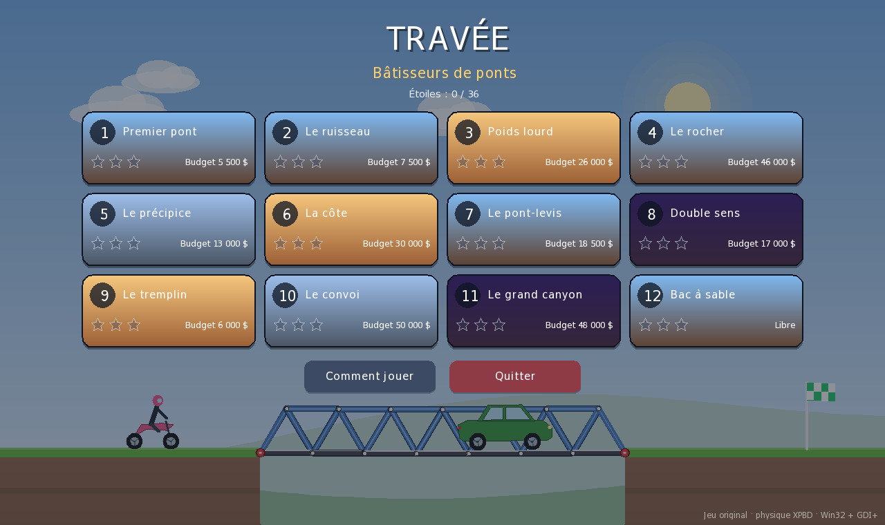
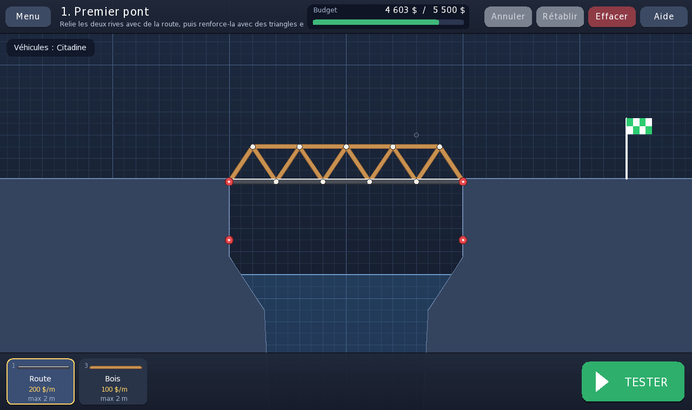

# Travée — Bâtisseurs de ponts

Jeu original de construction de ponts en 2D pour Windows, écrit en C++ (Win32 + GDI+),
compilé en véritable exécutable **PE32+ 64 bits** (`dist/Travee.exe`, autonome, sans DLL à fournir).

Construis des ponts avec différents matériaux, lance la simulation physique et regarde
voitures, motos, bus, camions et semi-remorques traverser… ou finir dans l'eau.



| Éditeur (vue plan)            | Pont-levis et bateau            |
|-------------------------------|---------------------------------|
|     |    |
| **Convoi lourd**              | **Rupture sous un camion de 10 t** |
|     |     |
| **Tremplin pour 4x4**         | **Grand canyon, vue des contraintes** |
|         |       |

## Contenu

- **12 niveaux** : premier pont, ruisseau, poids lourd, rocher central, gouffre à câbles,
  côte à gravir, pont-levis avec bateau, double sens, tremplin pour 4x4, convoi lourd,
  grand canyon, et un bac à sable au budget illimité.
- **8 matériaux** :

  | Matériau        | Coût/m | Longueur max | Particularité                                |
  |-----------------|-------:|-------------:|----------------------------------------------|
  | Route           |  200 $ |          2 m | Seule surface où roulent les véhicules        |
  | Route renforcée |  360 $ |          2 m | Pour bus et camions                           |
  | Bois            |  100 $ |          2 m | Léger, bon marché                             |
  | Acier           |  400 $ |          4 m | Très solide                                   |
  | Corde           |   30 $ |         10 m | Traction seulement, souple                    |
  | Câble           |   90 $ |         20 m | Traction seulement, très résistant            |
  | Ressort         |  220 $ |          2 m | Élastique, absorbe les chocs                  |
  | Vérin           |  600 $ |          4 m | S'allonge ou se rétracte avec [H], course réglable |

- **8 véhicules** : citadine, moto, fourgon, 4x4, bus, camion-benne (10 t), semi-remorque
  articulée (tracteur + remorque), et bateaux qui passent sous les ponts-levis.
- Simulation physique **XPBD** (32 sous-pas par image) : poutres élastiques qui se tordent et
  **cassent** quand l'effort dépasse leur résistance, suspensions amorties, adhérence des
  roues, flottaison, éclaboussures.
- Vue des **contraintes** (vert → rouge), ralenti/accéléré, pause.
- Budget, étoiles (★ réussi, ★★ ≤ 90 % du budget, ★★★ ≤ 75 %), records.
- Sauvegarde automatique de la progression et des ponts (`travee_sauvegarde.txt` à côté de l'exe,
  ou dans `%APPDATA%\Travee` si le dossier est protégé).
- Sons synthétisés à la volée (pose, rupture, plouf, klaxon, victoire).

## Commandes

| Action                         | Commande                                              |
|--------------------------------|-------------------------------------------------------|
| Poser une poutre               | Clic gauche sur une articulation, glisser et relâcher |
| Poser en chaîne                | Clic sur une articulation, puis un clic par poutre    |
| Annuler la poutre en cours     | Clic droit ou Échap                                   |
| Supprimer                      | Clic droit (ou Suppr) sur une poutre / articulation   |
| Déplacer une articulation      | Maj + glisser                                         |
| Placement libre (sans grille)  | Ctrl maintenu                                         |
| Choisir le matériau            | Touches 1 à 8 ou clic sur la palette                  |
| Régler un vérin                | + / − (ou Maj + molette) en survolant le vérin         |
| Tester / modifier              | Espace                                                |
| Actionner les vérins           | H (pendant le test)                                   |
| Contraintes / vitesse / pause  | T / F / P                                             |
| Zoom / déplacer la vue         | Molette / glisser dans le vide                        |
| Recentrer                      | R                                                     |
| Annuler / rétablir             | Ctrl+Z / Ctrl+Y                                       |
| Aide                           | F1                                                    |

## Compiler

Depuis Linux (cross-compilation) :

```bash
sudo apt install g++-mingw-w64-x86-64-posix
./build.sh            # produit dist/Travee.exe
```

Depuis Windows : lancer `build.bat` dans une invite « x64 Native Tools » de Visual Studio,
ou avec MinGW-w64/MSYS2 (`g++` dans le PATH).

## Tests

Le moteur (`src/core.h`) est indépendant de Windows. Le banc d'essai construit une conception de
référence pour chaque niveau, simule, et vérifie que tous les véhicules arrivent dans le budget,
puis vérifie qu'aucun niveau n'est réussi sans pont :

```bash
g++ -O2 -std=c++17 tests/sim_test.cpp -o sim_test && ./sim_test
```

L'exécutable accepte aussi un mode capture pour les tests automatiques :

```
Travee.exe --shot capture.bmp --level 7 --ref --sim 15 --hyd 9.5
```

## Fichiers

- `src/core.h` — maths, matériaux, véhicules, niveaux, conception, simulation physique.
- `src/main.cpp` — fenêtre Win32, rendu GDI+, interface, audio waveOut, sauvegarde.
- `tests/sim_test.cpp` — tests de la physique et des niveaux.
- `build.sh` / `build.bat` — scripts de compilation.
- `dist/Travee.exe` — exécutable Windows prêt à lancer.
